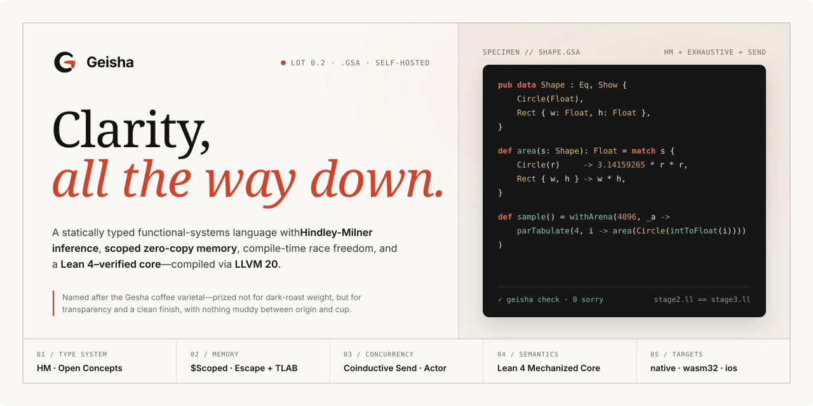

<p align="center">
  <picture>
    <source media="(prefers-color-scheme: dark)" srcset="docs/assets/hero-dark.svg">
    <source media="(prefers-color-scheme: light)" srcset="docs/assets/hero-light.svg">
    
  </picture>
</p>

<p align="center">
  <a href="docs/SPEC.md">Language Spec</a> ·
  <a href="docs/GETTING_STARTED.md">Getting Started</a> ·
  <a href="docs/PACKAGES_AND_TARGETS.md">Packages &amp; Targets</a> ·
  <a href="AGENT_GUIDE.md">Agent Guide</a> ·
  <a href="formal/SPEC.md">Lean 4 Proofs</a>
</p>

---

**Geisha** (`.gsa`) is a self-hosting, statically typed functional-systems language with Hindley-Milner inference, scoped zero-copy memory, compile-time race freedom, and a **Lean 4**–verified core—compiling via **LLVM 20** to `native`, `wasm32`, `ios`, and `ios-sim`, with a built-in Git/MVS package manager.

<sub>Named after the Gesha coffee varietal—prized not for dark-roast weight, but for transparency and a clean finish, with nothing muddy between origin and cup.</sub>

---

## Why Geisha?

Light as ML on the surface; exact to the metal underneath:

- **Hindley-Milner + Open Concepts**: Full type inference, algebraic data types, Maranget exhaustive pattern matching, multi-parameter Concepts with functional dependencies, and zero-keyword `Generic` deriving (`data User : Eq, Show { ... }`).
- **Compile-Time Data-Race Freedom**: Coinductive `Send` checking and a 3-point closure capture-mode lattice (`shared <: local <: scoped`), plus `Actor s` for encapsulating `!Send` mutable state behind a sequential mailbox.
- **Zero-Copy Scoped Regions**: `ForeignPtr`, `ScopedPtr`, and `Arena` enforce deterministic FFI/scratch lifetimes statically—preventing use-after-return at compile time.
- **Escape Analysis + Generational Bitmap GC**: 2-phase interprocedural escape analysis promotes non-escaping `Cell`s to the stack; escaping objects use a 256 KB TLAB nursery + 31 size classes with exact 40-bit pointer masks.
- **Zero-Server Package Manager**: Dependencies are addressed by Git URL (or `$GEISHA_INDEX`), resolved deterministically with **Minimal Version Selection (MVS)**, and pinned by SHA-256 in `geisha.lock`.
- **Agent-Native Tooling**: Built-in `geisha guide`, `geisha doc`, `geisha check --json`, and compact 1D diagnostics (`file:line:col: error[kind]: ...`).
- **Machine-Checked Core**: Core Geisha's type safety, data-race freedom, exhaustiveness, stack-escape safety, `$Scoped` regions, and generational GC invariants are proved in **Lean 4** with zero `sorry`s (`formal/`).

---

## Quick Taste

```geisha
use std.result.{Result, Ok, Err}
use std.str.intToStr

pub data Shape : Eq {
    Circle(Float),
    Rect { w: Float, h: Float },
}

def area(s: Shape): Float = match s {
    Circle(r) -> 3.141592653589793 * r * r,
    Rect { w, h } -> w * h,
}

def main(): Void = {
    let items = [Circle(2.0), Rect { w: 3.0, h: 4.0 }];
    let total = parTabulate(2, i -> if (i == 0) 10 else 20);
    printLn("sum = " + intToStr(immArrayGet(total, 0) + immArrayGet(total, 1)))
}
```

Or run standalone scripts directly without a `geisha.toml`:

```sh
geisha eval 'printLn("Hello, Geisha!")'
geisha run hello.gsa
```

---

## Documentation

| Document | Description |
| --- | --- |
| [**Language Specification**](docs/SPEC.md) | Complete normative reference for syntax, types, Concepts, `$Scoped` regions, `Send` concurrency, FFI, and `geisha.toml` |
| [**Getting Started**](docs/GETTING_STARTED.md) | Installation, script mode, projects, and a hands-on tour of Geisha |
| [**Packages & Targets**](docs/PACKAGES_AND_TARGETS.md) | Decentralized Git/MVS packages, `geisha.local.toml`, `[[target.native.when]]`, `wasm32`, `ios` / `ios-sim` |
| [**Agent Quick Reference**](AGENT_GUIDE.md) | Compact syntax, pitfalls, and `std.*`/`sys.*` index (also built into `geisha guide`) |
| [**Formal Semantics (`formal/`)**](formal/SPEC.md) | Machine-checked Lean 4 proofs of Core Geisha & `--dump-core` validation |

---

## Compiler Architecture

`geisha.gsa` implements the complete compiler pipeline and package manager in pure Geisha (`src/`) linked with a portable C11 runtime (`runtime/`):

| Module | Responsibility |
| --- | --- |
| `src/ast.gsa` | Core AST, Hindley-Milner `Type`/`Scheme`, patterns, module items, and 13-level operator precedence |
| `src/lexer.gsa` | Linear-time tokenizer with `hadNewline` tracking, shebang skipping, block comments, escapes, and symbolic ops |
| `src/parser.gsa` | Recursive-descent + Pratt parser, `(op)` sections, destructuring `let`, script mode, and `?` desugaring |
| `src/diag.gsa` | Compact 1D span diagnostics (`file:line:col: error[kind]: ...` + `near:` + `hint:`) |
| `src/loader.gsa` | Path-as-module `use`/`open` loader, sibling umbrella modules, hermetic package scoping, and Orphan Rule checking |
| `src/infer.gsa` | HM type inference, open Concepts/Instances, `Generic` deriving, `$Scoped` & `Send` checking, and Maranget exhaustiveness |
| `src/core.gsa` | K-conversion, lambda lifting, closure conversion, worklist monomorphization, static Concept dispatch, and 2-phase escape analysis |
| `src/codegen.gsa` | LP64 / Wasm32 ABI layout calculator, 40-bit pointer masks, and LLVM 20 opaque-pointer IR (`.ll`) emitter |
| `src/pkg.gsa` | Zero-server Git/MVS package manager (`geisha.toml`, `geisha.local.toml`, `geisha.lock`), `~/.geisha/cache`, and native/wasm32/iOS builder |
| `src/doc.gsa` | Built-in `geisha doc` signature & `///` doc-comment extractor |
| `src/bench.gsa` | Built-in `geisha bench` microbenchmark discovery, harness synthesis, and text/`--json` runner |
| `src/geisha.gsa` | Unified CLI driver (`init`, `add`, `remove`, `fetch`, `update`, `build`, `check`, `run`, `eval`, `test`, `bench`, `doc`, `guide`) |

---

## Bootstrapping, Installation & Verification

Run the 3-stage bootstrap and verify the fixed point (`stage2.ll == stage3.ll`). When `STAGE0` is omitted, `Makefile` compiles `bootstrap/stage0.ll.xz` into `build/geisha0` automatically:

```sh
make runtime wasm-runtime bootstrap
```

Install the toolchain (`geisha`, `libgeisha_runtime.a`, `wasm_rt.o`) to `~/.geisha`:

```sh
make install
```

Run checks, tests, and Lean 4 formal verification:

```sh
make check-docs       # Verify AGENT_GUIDE.md, stdlib_bundle.gsa, guide_bundle.gsa, and CLI docs
make test             # End-to-end language & package manager test suite
make test-sanitizers  # ASan + UBSan & TSan runtime + generated LLVM IR stress suite
make verify-core      # Lean 4 zero-sorry proofs + full self-hosted compiler translation validation
```

Package a relocatable release archive (`dist/geisha-<version>-<os>-<arch>.tar.gz`):

```sh
make dist VERSION=v0.2.0
```
